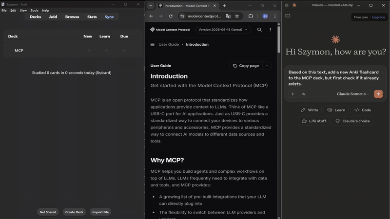

# Anki Connect MCP Server

A Model Context Protocol (MCP) server that provides seamless integration with Anki through the AnkiConnect add-on. This server enables AI assistants and other MCP clients to interact with your Anki flashcard collection programmatically.



## What is Anki Connect?

[AnkiConnect](https://ankiweb.net/shared/info/2055492159) is a powerful Anki add-on that exposes Anki's functionality through a REST API. It allows external applications to:

- Create, modify, and delete flashcards
- Manage decks and their configurations
- Control Anki's GUI programmatically
- Search and retrieve card information
- Manage tags and note types
- Perform bulk operations on cards and notes

## What is MCP (Model Context Protocol)?

The Model Context Protocol is a standardized way for AI assistants to connect to external data sources and tools. This MCP server acts as a bridge between MCP clients (like Claude Desktop) and AnkiConnect, allowing AI assistants to help you manage your Anki flashcards naturally through conversation.

## Features

Every tool comes with a description, a title and MCP annotations (`readOnlyHint` / `destructiveHint`), so clients can auto-approve read-only tools and ask before destructive ones. On connect the server also sends instructions for the agent: Anki search syntax, note IDs vs card IDs, and the recommended flow for adding cards.

Errors are reported as tool errors (`isError: true`): `AnkiConnect error: ...` when Anki rejects a request, `Could not reach AnkiConnect at <url>...` when Anki is not running, and a plain message describing the problem when the arguments are wrong (e.g. an unknown field name).

### Default tools

- **Notes:** `add_note`, `add_notes`, `can_add_notes`, `update_note_fields`, `add_tags`, `remove_tags`, `find_notes`, `notes_info`
- **Cards:** `find_cards`, `cards_info`, `cards_to_notes`, `suspend`, `unsuspend`, `are_suspended`, `are_due`, `get_intervals`
- **Decks:** `deck_names`, `deck_names_and_ids`, `get_decks`, `change_deck`, `delete_decks`, `get_deck_config`
- **Models:** `model_names`, `model_names_and_ids`, `model_field_names`, `model_fields_on_templates`
- **Misc:** `version`, `get_tags`
- **Media:** `store_media_file`, `get_media_files_names`, `retrieve_media_file`, `delete_media_file`, `get_media_dir_path`

`find_notes` and `find_cards` return `{ ids, total, truncated }` and accept an optional `limit` (default 100); `get_media_files_names` returns `{ names, total, truncated }` the same way. `cards_info` strips the card CSS from the question and answer.

Images, audio and video: `add_note`, `add_notes` and `update_note_fields` take `picture`, `audio` and `video` arrays of `{ source, filename?, fields }`. `source` is an http(s) URL or an absolute path on the computer running Anki. Anki itself downloads or reads it, so a path must exist on that machine. The file is stored and appended to each listed field. To place an image inside text instead, call `store_media_file` and write `` with the returned name; Anki may rename files, so never assume the requested name. If a file cannot be stored, no note is created or changed and the error names the failing item. `retrieve_media_file` returns PNG, JPEG, GIF and WebP images up to 5 MB as image content the agent can see.

### Optional tool groups

| Group | Enabled by | Tools |
|-------|-----------|-------|
| GUI | `ANKI_MCP_ENABLE_GUI=1` | `gui_browse`, `gui_add_cards`, `gui_current_card`, `gui_start_card_timer`, `gui_show_question`, `gui_show_answer`, `gui_answer_card`, `gui_deck_overview`, `gui_deck_browser`, `gui_deck_review`, `gui_exit_anki` |
| Advanced | `ANKI_MCP_ENABLE_ADVANCED=1` | `multi`, `upgrade`, `save_deck_config`, `set_deck_config_id`, `clone_deck_config_id`, `remove_deck_config_id` |

## Configuration

| Variable | Default | Purpose |
|----------|---------|---------|
| `ANKI_CONNECT_URL` | `http://localhost:8765` | AnkiConnect address |
| `ANKI_CONNECT_API_KEY` | – | Sent as `key` with every request; set it when AnkiConnect has `apiKey` configured |
| `ANKI_MCP_ENABLE_GUI` | off | `1` or `true` enables the GUI tools |
| `ANKI_MCP_ENABLE_ADVANCED` | off | `1` or `true` enables the advanced tools |

### Upgrading from 2.x

- `audio` on `add_note` / `add_notes` is now an array of `{ source, filename?, fields[] }`; it used to be a single object with `url`, `filename`, `skipHash` and a single `fields` string.
- `update_note_fields` is no longer marked idempotent (`idempotentHint: false`), because attaching media appends a new tag on every call. Its `fields` is now optional.
- Five media tools are now in the default group: `store_media_file`, `get_media_files_names`, `retrieve_media_file`, `delete_media_file` (destructive) and `get_media_dir_path`.

### Upgrading from 1.x

- `create_flashcard` was removed; use `add_note` with `deckName`, `modelName` and `fields`.
- GUI tools, `multi`, `upgrade` and deck-config editing tools are hidden unless their group is enabled.
- Tool results contain only AnkiConnect's `result` (no `{result, error}` envelope); errors come back as tool errors.
- `find_notes` / `find_cards` return `{ ids, total, truncated }` instead of a plain array.
- Node.js 20 or newer is required.

## Prerequisites

### 1. Install AnkiConnect Add-on

1. Open Anki
2. Go to **Tools** → **Add-ons**
3. Click **Get Add-ons...**
4. Enter the code: `2055492159`
5. Click **OK** and restart Anki

### 2. Configure AnkiConnect (Optional)

AnkiConnect works out of the box, but you can customize its settings:

1. Go to **Tools** → **Add-ons**
2. Select **AnkiConnect** and click **Config**
3. Modify settings if needed (default port is 8765)
4. Restart Anki after making changes

## Installation

1. Clone this repository:
```bash
git clone https://github.com/spacholski1225/anki-connect-mcp.git
cd anki-connect-mcp
```

2. Install dependencies:
```bash
npm install
```

3. Build the project:
```bash
npm run build
```

## MCP Client Configuration

### Claude Desktop

To use this MCP server with Claude Desktop, add the following configuration to your MCP settings file:

**Location of MCP configuration file:**
- **Windows**: `%APPDATA%\Claude\claude_desktop_config.json`
- **macOS**: `~/Library/Application Support/Claude/claude_desktop_config.json`
- **Linux**: `~/.config/Claude/claude_desktop_config.json`

**Configuration Options:**

#### Option 1: Using Node.js (Local Installation)
```json
{
  "mcpServers": {
    "anki-connect-mcp": {
      "command": "node",
      "args": [
        "dist/index.js"
      ],
      "env": {},
      "disabled": false,
      "alwaysAllow": [
        "deck_names",
        "cards_info",
        "deck_names_and_ids",
        "find_notes"
      ]
    }
  }
}
```

#### Option 2: Using npx (NPM Package)

**Then configure your MCP client:**
```json
{
  "mcpServers": {
    "anki-connect": {
      "command": "npx",
      "args": [
        "@spacholski1225/anki-connect-mcp"
      ],
      "env": {},
      "disabled": false,
      "alwaysAllow": [
        "deck_names",
        "cards_info",
        "deck_names_and_ids",
        "find_notes"
      ]
    }
  }
}
```

#### Option 3: Using Docker
```json
{
  "mcpServers": {
    "anki-connect": {
      "command": "docker",
      "args": [
        "run",
        "--rm",
        "-i",
        "--network=host",
        "-e", "ANKI_CONNECT_URL=http://host.docker.internal:8765",
        "spacholski/anki-connect-mcp:latest"
      ],
      "env": {},
      "disabled": false,
      "alwaysAllow": [
        "deck_names",
        "cards_info",
        "deck_names_and_ids",
        "find_notes"
      ]
    }
  }
}
```

**Docker-Specific AnkiConnect Configuration:**

When using the Docker option, you **must** configure AnkiConnect with specific settings to allow Docker container access:

1. Go to **Tools** → **Add-ons** in Anki
2. Select **AnkiConnect** and click **Config**
3. Update the configuration with the following settings:

```json
{
    "apiKey": null,
    "apiLogPath": null,
    "ignoreOriginList": [],
    "webBindAddress": "0.0.0.0",
    "webBindPort": 8765,
    "webCorsOriginList": [
        "http://localhost",
        "http://host.docker.internal",
        "http://host.docker.internal:3000"
    ]
}
```

**Key Docker Configuration Points:**
- **`webBindAddress: "0.0.0.0"`** - Allows AnkiConnect to accept connections from any IP address (required for Docker containers)
- **`webCorsOriginList`** - Must include `"http://host.docker.internal"` and related origins to allow cross-origin requests from Docker containers
- Restart Anki after making these configuration changes

**Important Notes:**
- **For Node.js option**: Replace the path in `args` with the actual path to your built `index.js` file
- **For npx option**: Uses the published NPM package `@spacholski1225/anki-connect-mcp` - no local installation required
- **For Docker option**: Uses the pre-built Docker image `spacholski/anki-connect-mcp:latest`
- The `alwaysAllow` array contains tools that won't require confirmation each time
- Make sure Anki is running with AnkiConnect enabled before using the MCP server
- For Docker option, the `--network=host` flag allows the container to access AnkiConnect on the host machine

## Usage Examples

Once configured with an MCP client like Claude Desktop, you can interact with your Anki collection naturally:

- *"Create a flashcard about the capital of France in my Geography deck"*
- *"Show me all my deck names"*
- *"Find all cards tagged with 'vocabulary'"*
- *"Suspend all cards in the 'Difficult Words' deck"*
- *"Open the deck browser in Anki"* (needs `ANKI_MCP_ENABLE_GUI=1`)

## Troubleshooting

### Common Issues

1. **Connection refused**: Make sure Anki is running and AnkiConnect is installed
2. **Port conflicts**: Check if port 8765 is available or configure AnkiConnect to use a different port
3. **Permission errors**: Ensure the MCP server has proper file system permissions
4. **Tool not found**: Verify the MCP client configuration and restart the client

## Development

```bash
npm run typecheck   # type-check sources and tests
npm test            # protocol-level tests against a fake AnkiConnect
npm run build
```

## Contributing

Contributions are welcome! Please feel free to submit issues, feature requests, or pull requests.

## License

MIT License

## References

- [AnkiConnect Documentation](https://foosoft.net/projects/anki-connect/)
- [Model Context Protocol Specification](https://modelcontextprotocol.io/)
- [MCP SDK Documentation](https://github.com/modelcontextprotocol/typescript-sdk)
